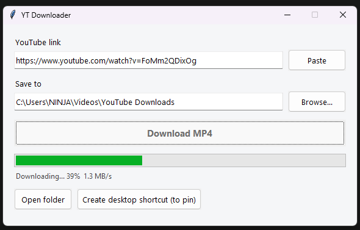
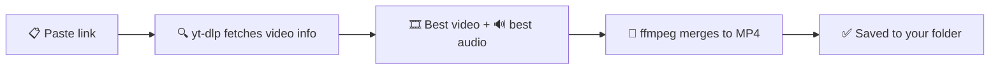

<div align="center">

# ⬇️ YT Downloader

### Paste a link. Click a button. Get your video.
**No ads. No malware. No bloatware. No background processes.**

<br>


<br>



</div>

<br>

---

## 💢 Why this exists

I got tired of it. Every "free YouTube downloader" website is a minefield of fake download buttons, pop-ups and malware. They take forever, and then hand you a compressed, degraded version of the video. The desktop apps are no better: they install bloatware that sits in the background eating your RAM and phoning home.

So I built the thing I actually wanted:

> **One small window. One job. Nothing running when you're not using it.**

That's the entire project. 🎯

---

## ✨ Features

| | |
|---|---|
| 🎬 **Best quality, as MP4** | Grabs the best available video and audio and merges them into a single, universally playable `.mp4` (H.264 + AAC preferred). |
| 🪶 **Truly lightweight** | One Python file. No installer, no service, no tray icon, no auto-start. Close the window and it's gone. |
| 🧰 **Zero manual setup** | `yt-dlp`, `ffmpeg` and a JavaScript runtime are installed automatically the first time you hit Download. |
| 📋 **Clipboard smart** | Copied a YouTube link? It's pre-filled when the app opens. Or use the **Paste** button. |
| 📊 **Live progress** | Real progress bar with percentage and download speed. |
| 📁 **Remembers your folder** | Pick a save location once; it's remembered next time. |
| 📌 **Pin it** | One click creates a Desktop shortcut you can pin to the taskbar or Start menu. |
| 🔇 **No console window** | Runs silently via `pythonw`. Just the GUI, nothing else. |
| 🔁 **Smart fallbacks** | If a preferred format isn't available, it automatically tries the next best one. |

---

## 🚀 Quick start

### 1. Install Python
Grab it from [python.org/downloads](https://www.python.org/downloads/) (3.10 or newer).

> ⚠️ During installation, tick **"Add python.exe to PATH"**.

### 2. Get the app
Download `yt_downloader_gui.py` from this repo (or clone it):

```bash
git clone https://github.com/YOUR-USERNAME/YOUR-REPO.git
cd YOUR-REPO
```

### 3. Run it

```bash
python yt_downloader_gui.py
```

…or just **double-click** the file.

> 💡 **Tip:** Rename it to `yt_downloader_gui.pyw` if you want double-clicking to open the app without a console window flashing. (The Desktop shortcut from the app already does this for you.)

### 4. Download something
1. Paste a YouTube link (or let it auto-fill from your clipboard).
2. Choose where to save it.
3. Press **Download MP4**. ✅

The **first** download takes a minute longer because the app is setting itself up. After that, it's instant.

---

## 📌 Pin it to your taskbar

1. Click **Create desktop shortcut (to pin)** inside the app.
2. Find **YT Downloader** on your Desktop.
3. Right-click it → **Pin to taskbar** (or **Pin to Start**).

> On Windows 11, you may need **Show more options** first, or you can simply drag the shortcut onto the taskbar.

---

## 🧠 How it works



On first run, the app quietly installs what it needs with `pip`:

| Component | Purpose |
|---|---|
| [`yt-dlp`](https://github.com/yt-dlp/yt-dlp) | The engine that talks to YouTube and downloads the streams |
| [`imageio-ffmpeg`](https://github.com/imageio/imageio-ffmpeg) | Bundled `ffmpeg` binary, used to merge video and audio into MP4 |
| [`deno`](https://deno.com/) | A JavaScript runtime that yt-dlp needs to solve YouTube's player challenges |

If you already have `ffmpeg`, `deno` or `node` installed, the app finds and uses those instead.

---

## 🔒 Privacy & "no bloat" promise

- ❌ No telemetry, analytics or tracking
- ❌ No ads, no accounts, no logins
- ❌ No background services, startup entries or tray icons
- ❌ No installer touching your registry
- ✅ Open source, **one readable file**. Audit it in five minutes.

The app only talks to YouTube (to download the video) and to PyPI / GitHub (to install and update its helper tools). It stores a single tiny settings file with your chosen folder: `~/.yt_downloader_gui.json`.

---

## 🆚 How it compares

|  | Sketchy websites | Typical desktop apps | **YT Downloader** |
|---|:---:|:---:|:---:|
| Free | ✅ | ⚠️ often freemium | ✅ |
| Malware / pop-up risk | 🔴 High | 🟡 Varies | 🟢 None |
| Full video quality | ❌ often degraded | ⚠️ sometimes | ✅ |
| Background processes | n/a | 🔴 Often | 🟢 None |
| Installer needed | ❌ | ✅ | ❌ |
| Source you can read | ❌ | ❌ | ✅ |

---

## 🛠️ Troubleshooting

<details>
<summary><b>"That format isn't available" / download fails</b></summary>

<br>

This usually means no JavaScript runtime could be set up. Open a terminal and run:

```bash
winget install DenoLand.Deno
```

Then restart the app.
</details>

<details>
<summary><b>It stopped working after months of use</b></summary>

<br>

YouTube changes things often, and `yt-dlp` updates to keep up. Update it manually with:

```bash
python -m pip install -U "yt-dlp[default]"
```
</details>

<details>
<summary><b>The first download is slow to start</b></summary>

<br>

That's the one-time setup (installing `yt-dlp`, `ffmpeg` and `deno`). The progress bar will pulse while it works. Every download after that starts right away.
</details>

<details>
<summary><b>It downloaded only one video from a playlist link</b></summary>

<br>

That's by design. Pasting a link that includes a playlist downloads just the single video you linked to.
</details>

<details>
<summary><b>Where did my video go?</b></summary>

<br>

By default: `C:\Users\<you>\Videos\YouTube Downloads`. Click **Open folder** in the app to jump straight there.
</details>

---

## 🧹 Uninstall

Since nothing was installed system-wide, there's very little to remove:

1. Delete `yt_downloader_gui.py` and the Desktop shortcut.
2. Delete the settings file: `%USERPROFILE%\.yt_downloader_gui.json`
3. *(Optional)* Remove the helper packages:

```bash
pip uninstall yt-dlp yt-dlp-ejs imageio-ffmpeg deno
```

---

## ⚖️ Disclaimer

This tool is intended for **personal use**, such as saving content you have the right to download. Please respect copyright law, creators' rights and [YouTube's Terms of Service](https://www.youtube.com/t/terms). You are responsible for how you use it.

---

## 🙏 Credits

All the heavy lifting is done by the incredible [**yt-dlp**](https://github.com/yt-dlp/yt-dlp) project and [**FFmpeg**](https://ffmpeg.org/). This app is just a clean, friendly window on top of them.

---

<div align="center">

**If this saved you from one more sketchy website, drop a ⭐ on the repo!**

Made with frustration and a lot of caffeine. 🥤

</div>
